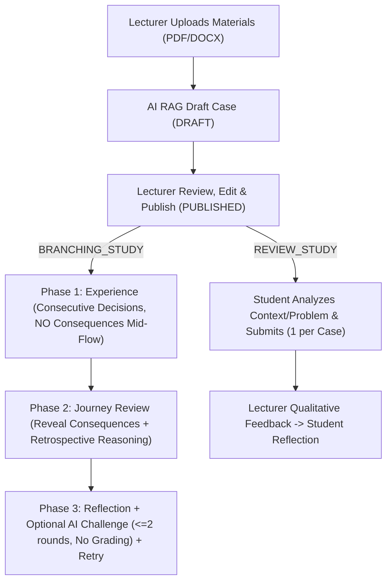

# EduBranch AI — Project Overview

> - **Document Class**: `[LIVING ARCHITECTURE / OPS SPEC]` (Executive Summary & Live `develop` Snapshot)
> - **Documentation Hub**: [`docs/README.md`](README.md) · **Live Task Status**: Jira `EBA` + [`docs/04_JIRA/JIRA-KEY-MAP.md`](04_JIRA/JIRA-KEY-MAP.md)
> - **Full Name**: EduBranch AI — AI Platform for Experiential Case-Based Learning in University Teaching · **Repository**: `https://github.com/HoangNam2464/EduBranch-AI`

---

## Problem Statement

University lecturers need engaging, pedagogically rich case studies that challenge students to make decisions under real-world uncertainty. Creating these manually is time-consuming and hard to scale. EduBranch AI automates case generation from existing teaching materials while keeping the lecturer in full control of what students receive and experience.

Students learn not by passively reading outcomes, but by making decisions, completing the full journey, then reviewing *how* each of their choices shaped the result — connecting personal experience to course material.

---

## Core Value Proposition

1. **AI generates case studies from the lecturer's own materials** — not generic content. Both Branching Study (interactive decision journeys) and Review Study (open analysis) cases are grounded in the actual syllabus, teaching materials, and course data uploaded by the lecturer.
2. **Lecturer reviews and controls publication** — mandatory human-in-the-loop (DRAFT → REVIEWED → APPROVED → PUBLISHED). No case reaches students without explicit lecturer approval.
3. **Supports dual learning modes**:
   - **Branching Study**: students experience a situational journey through consecutive decisions (no interruptions mid-flow), then enter a structured REVIEW phase to look back at every choice, understand its effect on the outcome, write retrospective reasoning, reflect, and optionally retry with a new attempt.
   - **Review Study**: students analyze case context and data, propose a solution with reasoning, receive qualitative lecturer feedback, and complete a reflection. No decision tree required.
4. **AI Reasoning / Challenge Support probes reasoning** — Socratic counter-questions (1–2 rounds, NO grading, NO scoring, NO pass/fail).
5. **Lecturer feedback & statistics** — qualitative commentary on student attempts/submissions, plus branch selection frequency and completion statistics for classroom discussion.

---

## Primary Actors

| Actor | Role |
|---|---|
| **Lecturer** | Creates courses; uploads teaching materials; triggers AI case generation; inspects, edits, approves, and publishes cases; shares case link with students; reviews student attempts/submissions; writes qualitative feedback; uses statistics for class discussion. |
| **Student** | Joins a class by invite code and opens published cases from the student desk or "My courses"; a direct link from the lecturer also works. In Branching Study: navigates the experience, makes consecutive decisions, completes the journey, reviews the full path retrospectively, writes reasoning and reflection, and may retry. In Review Study: analyzes context, proposes solution, receives feedback, reflects. |
| **Admin** | System administrator (Proposal V1.2 Context Diagram): manages user accounts and roles, manages courses, monitors API and system health logs. |

> **Students do not create cases.** Students only ever open `PUBLISHED` cases (INV-01); the student desk and My courses list only classes they joined. Update 2026-11-12 (PO decision OPD-001 → A): students join a class with an invite code and browse their courses and assigned cases on the student desk; the direct case link from the lecturer remains available.

---

## Core Workflow Summary

Detailed sequence diagrams for all 7 flows live in [`docs/architecture/DATA-FLOW.md`](architecture/DATA-FLOW.md); full mode rules live in [`FEATURE-BRANCHING-STUDY.md`](features/FEATURE-BRANCHING-STUDY.md) and [`FEATURE-REVIEW-STUDY.md`](features/FEATURE-REVIEW-STUDY.md).

---

## Architecture Summary

> Full 3-tier Mermaid architecture & service boundaries: [`SYSTEM-ARCHITECTURE.md`](architecture/SYSTEM-ARCHITECTURE.md) and [`SERVICE-BOUNDARIES.md`](architecture/SERVICE-BOUNDARIES.md).

| Layer | Technology | Role |
|---|---|---|
| Frontend | React 19 + Vite + TypeScript + TailwindCSS v4 + ReactFlow | Lecturer, Student & Admin UI (`Plus Jakarta Sans` + `Inter` target, Light-only) |
| Backend Gateway | Node.js (NestJS 10 + TypeScript, raw SQL `pg`) | API Gateway, business state, persistence (`V1`–`V5`) |
| AI Service | FastAPI (Python 3.12) + Pydantic v2 | Document parsing, RAG, case generation, challenge support (Internal) |
| Vector DB | PostgreSQL 16 + pgvector | Embeddings (`vector(768)`) + relational business data |
| Cache & Session | Redis 7 | Caching, session store |
| Object Storage | MinIO | PDF/DOCX teaching material storage |
| LLM | Gemini 3.5 Flash (`gemini-3.5-flash`; embeddings `gemini-embedding-001` 768-dim) / OpenAI GPT-4o-mini | Provider abstraction (`providers/factory.py`) |

---

## Documentation Navigation

Use [`docs/README.md`](README.md) as the unified Documentation Hub for the full classified index across Rules, PO Scope Decisions, Architecture, Design (`R01` / `P0`–`P4` / `UX-SCREEN-NOTES.md`), 15 Feature Specs, Baselines, Jira Mapping, and QA Reports.

---

## Feature Status (as of 2026-11-27)

> **Baseline**: `develop` `cf3a6a5` (merge PR #91). The MVP completion phase closed with **QG7 PASS** on this commit. It covers PRs #87, #88, #89, #90, #91, #92; PR #59 and #74 were closed and point to their replacement PRs. Evidence, test numbers and remaining exceptions: [`docs/qa/MVP-BASELINE-QG7-REPORT.md`](qa/MVP-BASELINE-QG7-REPORT.md).
>
> Status words:
> - **Implemented**: code on `develop` with automated tests.
> - **Partial**: some flows or backend endpoints are missing.
> - **Documented / Skeleton**: boundary only.
>
> Implemented never means PO-accepted or Done in Jira (`AGENTS.md` rule 10).
>
> QG7 at `cf3a6a5` (clean clone):
> - backend unit 410/410; e2e 337 pass, 43 skip (live suites); matrix 26/26; regression 44/44;
> - frontend lint 0, unit 321/321, build 0;
> - ai-service 165 passed, 1 xfailed (QA-005);
> - `start:prod` and Docker image run;
> - browser checks 84/84;
> - Backend and Frontend CI success on `develop` at `cf3a6a5`; AI Service CI success at `19a1a2b` (PR #92, the last ai-service change).

| Feature Area | Status | Evidence / gap |
|---|---|---|
| Authentication & Roles | Implemented (email/password, JWT, RBAC, rate limit) | Google/Microsoft sign-in (`BE-034`, EBA-101 In Progress) not on `develop`; forgot/reset password UI is MVP (PO 2026-11-25), backend reset API and `rememberMe` TTL not on `develop` (rule B4) |
| Course Context & Enrollment | Implemented | Soft archive (`OPD-014`), invite code + student desk (`BE-029`, `V5`); course read ownership in SQL (H3, PR #88) |
| Teaching Materials & Upload | Implemented | MinIO storage, PDF/DOCX validation, RAG source inspector UI |
| Document Processing & RAG | Implemented | parse → chunk → embed (768) → pgvector; `<sources>` boundary tests pass (F-07 fixed in PR #92); known defect QA-005 (stale chunks after failed re-ingest, xfail, EBA-116) |
| AI Case Generation | Implemented | 3-color DFS DAG validation, grounded prompting (`gemini-3.5-flash`) |
| Decision Tree / Case Editor | Implemented | node save with topology checks (`BE-017`), editor (`FE-009/010`); `findTreeViolation` vs AI terminal-path rule mismatch (EBA-117) |
| Lecturer Review & Publishing | Implemented | lifecycle state machine; published-only student gate (`INV-01`) for case reads and listings (H1–H2, PR #88); `INV-01` for **existing attempts** when a case leaves `PUBLISHED` (attempt view, choose, retrospective reasoning save, reflection, history) is blocked on PO decision D5 (EBA-113); reasoning reads already require `PUBLISHED`; post-publish editing `OPD-007` open |
| Branching Case Player & Attempts | Implemented | play → review → reflect → retry; attempt creation transactional (PR #88); resume rule `OPD-003` and retry limit `OPD-004` open |
| Review Study | Implemented (core) | BE-025 + FE `ReviewStudyPage` & `ReviewFeedbackPage` (`PR #69`); MVP scope confirmed (`P4` `(LATER)` removed per PO `2026-11-25`); `D4-13` remains `OPEN PO DECISION` |
| AI Challenge Support | Implemented | 2-round cap in gateway and AI service (`BE-027`, `FE-021`) |
| Lecturer Feedback & Statistics | Implemented (core) | `BE-026/028` + `FE-019`/`FE-022` (`PR #68`/`#70`/`#76`); route convention `/lecturer/feedback` vs `/lecturer/cases/:caseId/feedback`, `D-04`, `OPD-010` remain `OPEN PO DECISION` |
| Lecturer Dashboard | Implemented | FE (`PR #73`) + aggregation API `BE-030` (`GET /lecturer/dashboard`, PR #80); default lecturer route after login still an open PO item (`ROLE_HOME.LECTURER`) |
| Profile | Implemented | view + update (`GET`/`PATCH /users/me`, `BE-031`, PR #80) |
| Admin Portal | Implemented | admin screens for Figma frames 10.1–10.10 (`FE-031`/`FE-032`) on admin APIs `BE-032` (PR #80); 10.6 / 10.9 fixes in PR #91 (log filter groups, exact totals, VI/EN event labels); remaining Low items EBA-114 |
| Evaluation & Rubric | Implemented | rubric storage + anonymized CSV `BE-033` (PR #80); rubric UI `FE-029` (07.8 / 10.8) on that API (PR #89, replaces closed PR #74) |
| Notifications | Documented / Skeleton | `backend/src/modules/notification/` has no endpoints (Phase 2; `PSD-03` open) |
