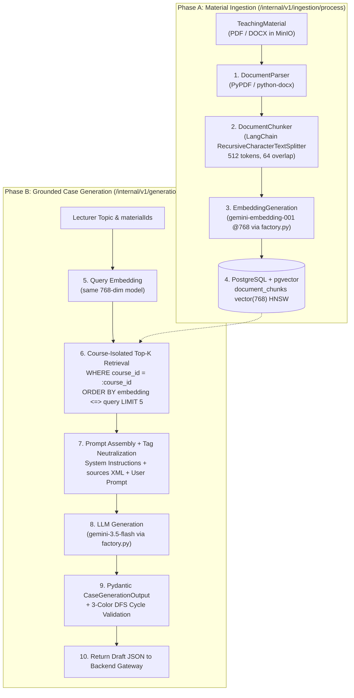

# EduBranch AI — RAG Pipeline

> - **Document Class**: `[LIVING ARCHITECTURE / OPS SPEC]` — **SSOT for Document Ingestion & Grounded Retrieval**
> - **Implementation Status**: Implemented (Internal FastAPI AI Service — `ingestion/`, `retrieval/`, `generation/`)

---

## Pipeline Overview

## Security Rules

- Retrieved chunks are UNTRUSTED DATA from uploaded documents
- ALL retrieved content MUST be enclosed in `<sources>...</sources>` boundary
- The boundary prevents source content from overriding system instructions (prompt injection mitigation)
- Never concatenate raw source text directly into the system prompt
- User-provided topic hints must be validated and sanitized

## Citation / Provenance

Each generated case should track which source chunks were used:
- `source_chunk_id` → `document_chunk.id`
- `document_id` → `teaching_material.id`
- `page_number` (if available from parser)

This enables citation traceability: case content → source chunk → original document.

## MVP Scope

- Basic top-K cosine similarity retrieval
- No reranking, BM25, query expansion, or multi-step retrieval in MVP
- Metadata filtering by course/material IDs
