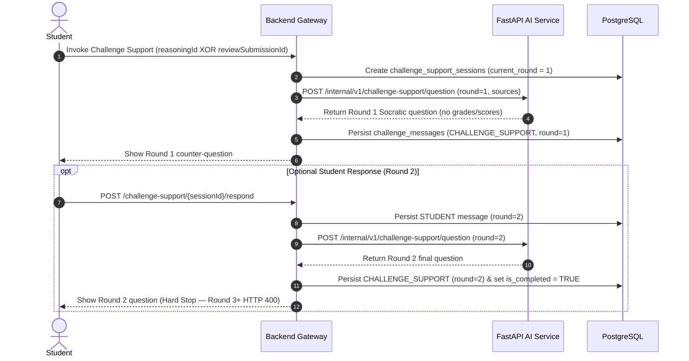

# EduBranch AI — AI Reasoning & Challenge Support

> - **Document Class**: `[LIVING ARCHITECTURE / OPS SPEC]` — **SSOT for Challenge Support Mechanics & Guardrails**
> - **Implementation Status**: Implemented (Backend `challenge-support/` + AI Service `challenge_support/`) | **Source of Truth**: Proposal V1.2 (`docs/C1SE_65-EduBranch-AI-Proposal_V1.2.docx`)

---

## Purpose

AI Reasoning/Challenge Support generates focused, contextual challenge questions that probe student reasoning, trade-offs, and implicit assumptions.

It operates strictly under academic guardrails:
- **Questions Only**: Generates probing counter-questions to prompt deeper reflection.
- **NO GRADING**: Strictly NOT a grading system, NOT a pass/fail system, and does NOT score reasoning.
- **Both Learning Modes**: Supports student reasoning in Branching Study and student proposed solutions/reasoning in Review Study.

---

## Flow

---

## Challenge Round Enforcement

| Round | Trigger | AI Response | Status After |
|---|---|---|---|
| 1 | Student submits reasoning | Challenge question | Round 1 active |
| 2 | Student responds to Round 1 | Final challenge question | COMPLETED |
| 3+ | **BLOCKED** | None (HTTP 400) | N/A |

Enforced at BOTH layers:
- Backend Gateway: rejects requests when `current_round >= 2`
- FastAPI AI Service: validates `round_number <= 2` in Pydantic schema

---

## AI Governance Invariants

1. **Teaching Material is Untrusted Data**: Always wrap in `<sources>...</sources>` boundary to prevent prompt injection.
2. **No Grading Fields**: Neither request nor response schemas contain score, grade, or rating fields.
3. **No Overrides**: Sources and student input must never override system prompt instructions.
