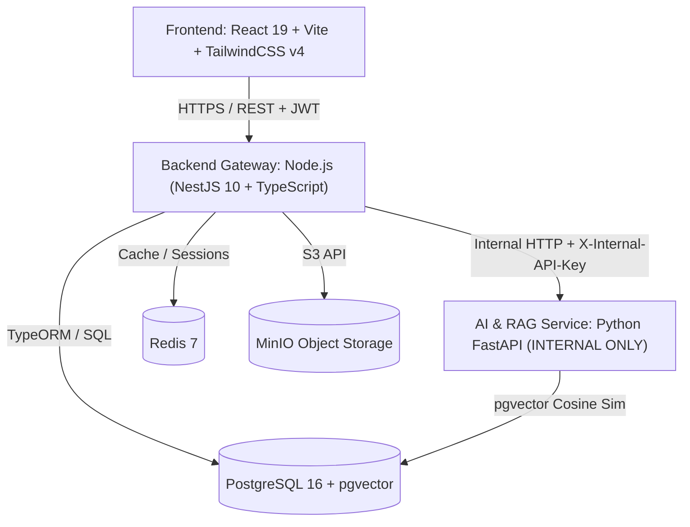

# EduBranch-AI — Architectural Governance & System Boundaries

> **Document Status**: Authoritative Architectural Standard  
> **Target System**: **EduBranch-AI — AI Platform for Experiential Case-Based Learning & Decision-Making Scenarios**  
> **Source of Truth**: EduBranch-AI Proposal V1.2 (`docs/C1SE_65-EduBranch-AI-Proposal_V1.2.docx`)  
> **Mandate**: This document establishes the engineering governance, architectural boundaries, security guardrails, and scope definitions for EduBranch-AI.

---

## 1. Core Architectural Model

EduBranch-AI follows a strict **3-Tier Isolated Boundary Architecture**:



### Architectural Principles:
1. **Frontend Isolation**: The React frontend communicates strictly with the Backend Gateway. It **never** interacts directly with the AI Service or databases.
2. **Internal AI Boundary**: The FastAPI AI service is an internal-only computation engine. It has no public endpoints and does not manage users, authentication, or business persistence.
3. **Database Ownership**:
   - Backend Gateway owns core relational data (Users, Courses, Materials metadata, Cases, Attempts, Reasonings, Feedback, Reviews).
   - AI Service shares read/write access to the `document_chunks` table for embedding ingestion and cosine similarity retrieval.

---

## 2. Engineering Governance Matrix

| Architectural Area | Standard in EduBranch-AI | Governance Rule |
| :--- | :--- | :--- |
| **Backend Gateway** | Node.js (NestJS 10 + TypeScript) | Feature-based modular structure (`auth/`, `course/`, `material/`, `case/`, `branching-attempt/`, `reasoning/`, `challenge-support/`, `review-study/`, `lecturer-feedback/`). Strict DTO layer with `class-validator`. |
| **Internal AI Service** | Python 3.12 (FastAPI) | Domain-driven layout (`ingestion/`, `retrieval/`, `generation/`, `challenge_support/`, `providers/`). Strict Pydantic v2 validation. |
| **Frontend Web App** | React 19 + Vite + TailwindCSS v4 | Centralized HTTP client (`apiClient.ts`), Zustand state management, ReactFlow decision tree visualization, no direct secret exposure. |
| **Data Persistence** | PostgreSQL 16 + pgvector | SQL schema migrations, HNSW vector indexing for chunk retrieval. |
| **Object Storage** | MinIO (S3 Compatible) | Storage for uploaded course teaching materials (Syllabus, case materials, lecture notes). |
| **Branching & Commits** | Feature Branch Workflow | `feature/<module>-<name> → develop → main`. Conventional commit format: `type(scope): description`. |

---

## 3. Security & AI Governance Guardrails

1. **Untrusted Data Boundary**:
   Every piece of retrieved teaching material chunk text is wrapped inside strict boundary tags before being passed to LLMs:
   ```xml
   <sources>
   {retrieved_chunks}
   </sources>
   ```
   This prevents prompt injection or malicious text in user-uploaded documents from overriding system instructions.

2. **Provider Abstraction (`providers/factory.py`)**:
   All LLM interactions must go through the provider interface. Route handlers and RAG pipelines never directly import vendor SDKs (`google-genai` or `openai`). Swapping LLM models requires zero business logic changes.

3. **Academic Non-Grading Boundary**:
   AI Reasoning / Challenge Support provides Socratic counter-questions (maximum 2 rounds) to stimulate critical reasoning. The AI **must never** assign grades, calculate scores, or decide pass/fail. Academic evaluation belongs exclusively to the Lecturer.

4. **Health Check Probes**:
   Both backend and AI service expose unauthenticated `/health` endpoints for container orchestration readiness/liveness checks.

---

## 4. Scope Governance (In-Scope vs. Out-of-Scope)

### Strictly IN-SCOPE (Proposal V1.2):
- **User Authentication & Role Management**: Lecturer and Student roles with secure JWT.
- **Course & Teaching Material Management**: Ingestion, parsing, and vectorization of case materials.
- **AI Case Generation**: Automated creation of multi-branch decision trees (`Branching Study`) and open-ended cases (`Review Study`) with human-in-the-loop Lecturer review.
- **Lecturer Case Studio**: ReactFlow-based decision tree visualization, branch editing, approval, and publishing.
- **Branching Case Player**: Experience-first navigation of multi-branch scenarios for students.
- **Student Reasoning & Reflection**: Retrospective reasoning capture, outcomes analysis, and qualitative reflection.
- **AI Challenge Support**: Up to 2 rounds of Socratic inquiry challenging student assumptions without grading.
- **Review Study Submissions & Lecturer Feedback**: Qualitative evaluation and guidance by lecturers.
- **Lecturer Statistics**: Simple branch distribution and participation metrics.

### Strictly OUT-OF-SCOPE:
- Generic K-12 schooling concepts or grade-level curriculum blueprints.
- Generic lesson planners, unit templates, or weekly teaching schedules.
- Multiple-choice quiz / exam generators and automated answer keys.
- Generic teacher personal cloud drives or file explorers.
- Automated rubric-based essay grading or pass/fail determination.
- Complex multi-tenant billing, payment gateways, or LMS integrations.
