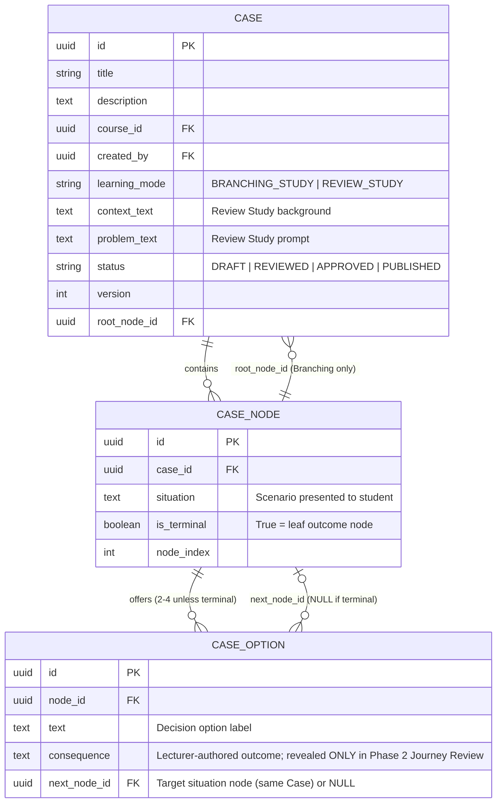
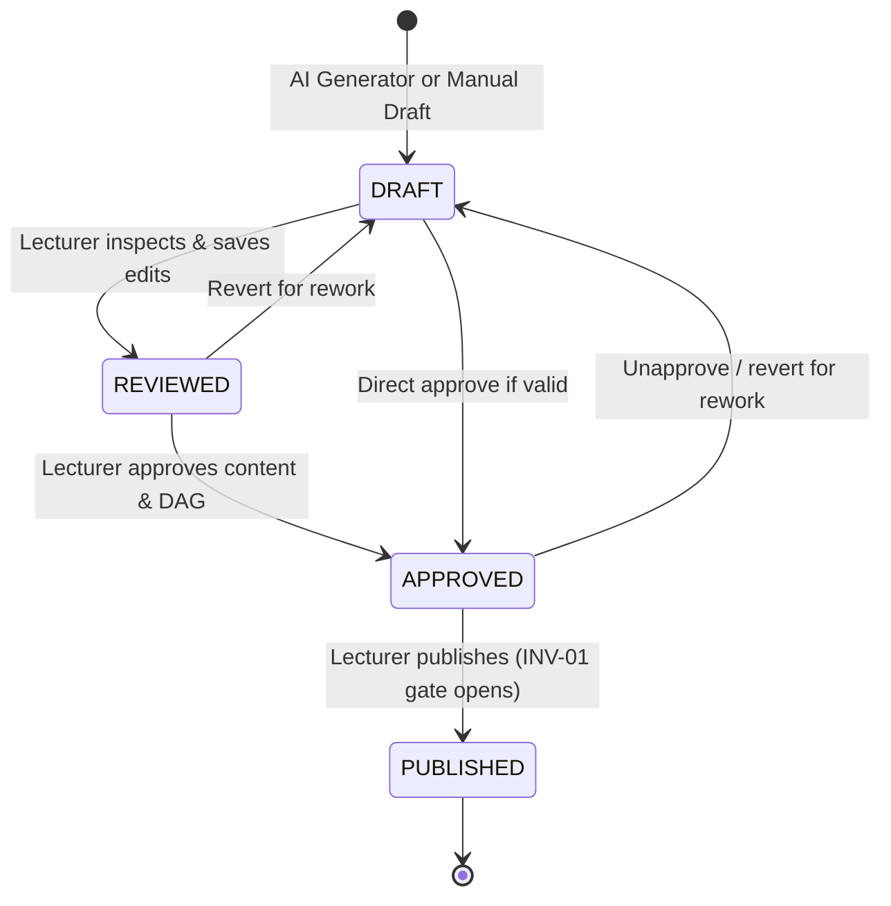

# EduBranch AI — Decision Tree Domain Model

> - **Document Class**: `[LIVING ARCHITECTURE / OPS SPEC]` — **SSOT for Decision Tree Data Structure, Structural Invariants & AI JSON Contract**
> - **Related Feature Spec**: [`docs/features/FEATURE-DECISION-TREE.md`](../features/FEATURE-DECISION-TREE.md) (functional requirements & permissions)
> - **Implementation Status**: Implemented in `backend/src/modules/case/` (`CaseTreeValidator`) and `ai-service/app/generation/schemas/` (3-color DFS)
> - **Source of Truth**: Proposal V1.2 (`docs/C1SE_65-EduBranch-AI-Proposal_V1.2.docx`)

---

## 1. Overview

The decision tree is the domain structure powering `BRANCHING_STUDY` mode in EduBranch AI (`learning_mode = 'REVIEW_STUDY'` cases use `context_text` and `problem_text` with `root_node_id = NULL`). A Branching Study `Case` is composed of `CaseNode` situations connected by directed `CaseOption` branches.

## 2. Entity Model



> **CRITICAL PEDAGOGICAL RULE (`FND §6.2`, `INV-02`, `INV-03`)**: `CaseOption.consequence` MUST NEVER be displayed immediately after selecting an option during **Phase 1 Experience**. All selected consequences are revealed exclusively during **Phase 2 Journey Review** after reaching a terminal node.

## 3. Structural Invariants

1. **No orphan nodes**: Every node (except root) must be reachable from rootNode
2. **No invalid references**: next_node_id must refer to a CaseNode in the same Case
3. **No cycles**: DFS 3-color cycle detection must pass before case can be saved
4. **At least one terminal**: Every decision tree must have at least one terminal path
5. **Root node is valid**: root_node_id must point to an existing CaseNode in the Case

## 4. JSON Representation (AI Output Format)

```json
{
  "title": "Supply Chain Ethics Dilemma",
  "description": "A case study on ethical sourcing decisions.",
  "root_node_index": 0,
  "nodes": [
    {
      "situation": "Your company discovers a key supplier uses unethical labor practices. What do you do?",
      "options": [
        {
          "text": "Immediately terminate the contract",
          "consequence": "Immediate supply disruption but strong ethical signal.",
          "next_node_index": 1
        },
        {
          "text": "Issue a warning and request an audit",
          "consequence": "Supplier relations maintained but risk of public backlash if leaked.",
          "next_node_index": 2
        }
      ]
    },
    {
      "situation": "The termination caused a 3-month production delay. How do you handle customer communication?",
      "options": [
        {
          "text": "Be fully transparent with customers",
          "consequence": "Loss of some orders but enhanced long-term brand trust.",
          "next_node_index": null
        }
      ]
    },
    {
      "situation": "The audit reveals systemic issues. Do you continue or terminate?",
      "options": [
        {
          "text": "Terminate after the audit period",
          "consequence": "Clean conscience, but faces same supply disruption as Option A.",
          "next_node_index": null
        }
      ]
    }
  ]
}
```

## 5. Case Lifecycle Flow



> **Post-Publish Editing (`OPD-007`)**: Versioning/unpublish policy for editing a `PUBLISHED` case with active student attempts remains an `OPEN PO DECISION` tracked in [`PRODUCT_OWNER_SCOPE_DECISIONS.md`](../mvp-scope/PRODUCT_OWNER_SCOPE_DECISIONS.md).

Students can ONLY see cases in PUBLISHED status.
