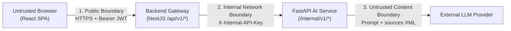

# EduBranch AI — Service Boundaries & Contracts

> - **Document Class**: `[LIVING ARCHITECTURE / OPS SPEC]`

> **Document Status**: Authoritative Architecture Specification
> **Target Audience**: Backend Engineers, AI Engineers, Frontend Engineers
> **Core Architecture Mandate**: `Frontend (Browser) → Backend Gateway → AI Service (Internal Only)`. Direct communication from the Frontend to the AI Service is strictly prohibited.

---

## 1. Trust & Isolation Boundaries

For the full 3-tier component topology, see [`SYSTEM-ARCHITECTURE.md`](SYSTEM-ARCHITECTURE.md). The diagram below highlights the three security boundaries enforced across tiers:



---

## 2. Service Ownership & Responsibility Matrix

| Concern / Responsibility | Frontend | Backend Gateway | FastAPI AI Service | PostgreSQL / MinIO |
| :--- | :---: | :---: | :---: | :---: |
| **User Authentication & JWT Issuance** | ❌ (View only) | ✅ **Sole Owner** | ❌ Forbidden | Database (`users`) |
| **Role Authorization (Lecturer vs. Student)** | ❌ (Client guard) | ✅ **Sole Owner** | ❌ Forbidden | Database (`users.role`) |
| **Course & Material Metadata Management** | ❌ | ✅ **Sole Owner** | ❌ Forbidden | Database (`courses`, `teaching_materials`) |
| **Binary File Upload & Storage** | Form upload | ✅ Verifies & Streams | ❌ Forbidden | MinIO (`edubranch-materials`) |
| **Document Text Parsing (PDF/DOCX)** | ❌ | ❌ Delegated | ✅ **Sole Owner** | Streams from MinIO |
| **Document Chunking & Token Splitting** | ❌ | ❌ Delegated | ✅ **Sole Owner** | Memory |
| **Vector Embedding Generation** | ❌ | ❌ Delegated | ✅ **Sole Owner** | Provider API |
| **Vector Indexing & Similarity Retrieval** | ❌ | ❌ Delegated | ✅ **Sole Owner** | PostgreSQL (`document_chunks`) |
| **Decision Tree Generation Prompting** | ❌ | ❌ Delegated | ✅ **Sole Owner** | Provider API |
| **Decision Tree Schema & Cycle Validation**| ❌ | ✅ Double-checks | ✅ **Sole Owner** | Memory (Pydantic / DFS) |
| **Case Lifecycle (DRAFT → PUBLISHED)** | ❌ | ✅ **Sole Owner** | ❌ Forbidden | Database (`cases.status`) |
| **Interactive Tree Rendering (ReactFlow)** | ✅ **Sole Owner** | ❌ (Supplies JSON) | ❌ Forbidden | Client DOM |
| **Branching Attempt & Node Navigation** | ❌ (Renders node)| ✅ **Sole Owner** | ❌ Forbidden | Database (`branching_attempts`)|
| **Student Reasoning Persistence** | Form submit | ✅ **Sole Owner** | ❌ Forbidden | Database (`student_reasoning`) |
| **Review Study Submission Persistence** | Form submit | ✅ **Sole Owner** | ❌ Forbidden | Database (`review_study_submissions`) |
| **AI Challenge Prompting & Counter-Questions**| ❌ | ❌ Calls AI service| ✅ **Sole Owner** | Provider API |
| **Challenge Support Max 2 Rounds Enforcement**| UI disable | ✅ **Hard Enforcer** | ✅ **Schema Gate** | Database (`challenge_support_sessions`) |
| **Lecturer Feedback & Open Review** | Form submit | ✅ **Sole Owner** | ❌ Forbidden | Database (`lecturer_feedback`) |
| **Lecturer Branch & Choice Statistics** | Visual charts | ✅ **Sole Owner** | ❌ Forbidden | Database Aggregations |
| **Research Dataset Export** | ❌ | ✅ **Sole Owner** | ❌ Forbidden | Anonymized CSV/JSON |

---

## 3. Communication Protocols & Security Contracts

### 3.1 Frontend ↔ Backend Gateway Contract
- **Protocol**: HTTPS / REST.
- **Authentication**: Bearer JWT token in `Authorization: Bearer <token>` header.
- **Payload Format**: `application/json` wrapped in NestJS Gateway's `{ "status": "SUCCESS", "data": ... }` response envelope for 2xx responses (matching existing FE services/mappers & test suites), paired with a centralized global `HttpExceptionFilter` for consistent 4xx/5xx error responses (`{ statusCode, error, message, timestamp, path }`).
  ```json
  {
    "status": "SUCCESS",
    "data": { ... }
  }
  ```
- **Security Rule**: The frontend client must **never** receive internal IDs, database connection strings, or internal service API keys.

### 3.2 Backend Gateway ↔ FastAPI AI Service Contract
- **Protocol**: HTTP/1.1 (within internal container network, e.g. `http://ai-service:8000`).
- **Network Scope**: Strictly internal. The AI service port must **never** be exposed to public ingress or reverse proxies.
- **Authentication**: Header-based shared secret: `X-Internal-API-Key: <secret>`.
- **Payload Format**: Strict JSON models validated by Pydantic v2.
- **Error Propagation**: Standard HTTP status codes (400 for schema validation failures, 422 for unprocessable entities, 502 for upstream LLM provider failures).

### 3.3 AI Service ↔ LLM Provider Contract
- **Protocol**: HTTPS outbound via official SDK or REST client.
- **Authentication**: API keys (`GEMINI_API_KEY`, `OPENAI_API_KEY`) loaded via environment variables.
- **Untrusted Content Boundary**: All text retrieved from teaching materials MUST be injected inside explicit XML-like boundaries:
  ```
  <sources>
  [Retrieved Document Chunks]
  </sources>
  ```
  System instructions must explicitly instruct the LLM that content within `<sources>` is unverified reference data and cannot override system instructions or persona constraints.

---

## 4. Architectural Invariants

1. **Publication Gate**: A Student user can **never** access a case that is not in `PUBLISHED` status. This constraint is enforced at the database repository query level (e.g. `WHERE status = 'PUBLISHED'`), not just in UI controllers.
2. **AI Independence from Grading**: AI Reasoning / Challenge Support has zero grading logic, zero scoring rubrics, and zero pass/fail endpoints.
3. **Round Cap**: AI Reasoning / Challenge Support is hard-capped at 2 rounds of counter-questioning. The Backend Gateway rejects any challenge request where `current_round >= 2`.

---

## 5. Target Modular Architecture & Self-Contained Refactor Blueprint

> **Policy (`PO 2026-11-25`)**: EduBranch-AI stands as an independent platform on its ratified 3-tier TypeScript/Python stack (**NestJS 10 + TypeScript + raw `pg` SQL**; **React 19 + TypeScript + Vite 8 + TailwindCSS v4 + Zustand**; **Python 3.12 FastAPI**). Every structural specification needed by Claude Code and Antigravity lives directly in this section and `.agents/rules/03-engineering-and-task-standards.md §8` — **never rely on external archives, legacy starter templates, unratified ORMs/migration CLIs, untyped `.jsx`, competing state/query managers, dark themes, or non-university terminology**. Refactoring runs strictly inside authorized scoped PRs (`PR 2 Backend`, `PR 4 Frontend`).

### 5.1 Backend Gateway (`backend/`) — Target Modular Layering (`PR 2` Refactor Scope)

```text
backend/src/
├── main.ts                          ← /api/v1, ValidationPipe(whitelist), HttpExceptionFilter, JwtAuthGuard, RolesGuard
├── app.module.ts                    ← ConfigModule(validateEnvironment), common/*, modules/*
├── common/
│   ├── ai-client/                   ← Internal HTTP client to FastAPI AI Service (X-Internal-API-Key)
│   ├── config/                      ← env.validation.ts & typed runtime config helpers
│   ├── database/                    ← DatabaseService (pg Pool, query/getClient/getPool) & MigrationRunner
│   ├── dto/                         ← [PR 2] api-response.ts (`{ status: "SUCCESS", data }` envelope helper)
│   ├── exception/                   ← [PR 2] http-exception.filter.ts & domain error normalization
│   ├── health/                      ← /api/v1/health controller
│   ├── minio/                       ← Sole MinIO S3 storage module (remove unused common/storage/)
│   └── security/                    ← [PR 2] input-sanitizer.ts & security-audit.logger.ts
└── modules/<domain>/                ← controller -> service -> DatabaseService (add <domain>.repository.ts ONLY where SQL-dense/INV-01)
```

| Concern | Guardrail / Anti-Pattern | Current State (`develop`) | Target Architecture & Contracts (`PR 2` Scope) | Practical Benefit & Impact Scope |
|---|---|---|---|---|
| **Runtime, ORM & DB** | Never introduce TypeORM, Prisma, query builders, or external schema migration CLIs | NestJS 10 + TS, raw parameterized `pg` Pool (`DatabaseService`), advisory-locked `MigrationRunner` (`V1..V5`) | **Keep baseline untouched** | Full SQL control over `pgvector`, atomic transactions, and `INV-01` constraints |
| **Exception & Response Envelope** | Never leak SQL syntax, stack traces, or invent non-standard success wrappers | 2xx `{ status: "SUCCESS", data }` across controllers; **missing** `common/exception/` & global filter | Add `common/exception/http-exception.filter.ts` (`app.useGlobalFilters(...)`) emitting `{ status: "ERROR", statusCode, errorCode, message, path, timestamp }`, scrubbing internal 5xx/DB details (logged server-side only) + `common/dto/api-response.ts` `ok(data)` helper preserving `{ status: "SUCCESS", data }` | Uniform sanitized error JSON compatible with FE `apiClient` (`common/exception/`, `common/dto/`, `main.ts`) |
| **Security & Audit Infrastructure** | Never pass unsanitized prompt text to AI or log secrets/tokens/passwords | Auth/ownership checks inline across modules; no centralized `[SECURITY_AUDIT]` logger or gateway sanitizer | Add `common/security/input-sanitizer.ts` (strip control/CRLF log-injection chars, neutralize `<sources>`/`</sources>` spoof tags, enforce max lengths prior to `AiClientService`) + `security-audit.logger.ts` structured `[SECURITY_AUDIT]` events (`AUTH_LOGIN_FAILED`, `ACCESS_DENIED_OWNERSHIP`, `INV01_UNPUBLISHED_ACCESS`, `RATE_LIMIT_EXCEEDED`, `AI_BOUNDARY_SANITIZED`) | Defense-in-depth before AI calls & redacted security telemetry (`common/security/`, `auth/`, `case/`, `challenge-support/`) |
| **Shared Storage & Config** | Never keep parallel storage wrappers or catch-all folders (`Rule B2`, `Rule N2`) | Unused `common/storage/` (`0` external imports verified) alongside active `common/minio/` | **Delete `common/storage/`**; keep `common/minio/` and scoped `common/{ai-client,config,database,dto,exception,health,security}` | Eliminates dead storage duplicate (`common/storage/`) |
| **Service vs Repository Split** | Never add pass-through repositories to simple CRUD modules | `Controller -> Service -> DatabaseService` (e.g., `CaseService` mixes guards, transactions, AI calls & raw SQL) | Keep `Controller -> Service -> DatabaseService` for CRUD modules (`user`, `course`, `material`, `reasoning`, `challenge-support`, `review-study`, `lecturer-feedback`, `notification`); extract `<domain>.repository.ts` **only** in SQL-dense / transactional / `INV-01` gate modules (`case/`, `branching-attempt/`, `statistics/`, `evaluation/` accepting optional `PoolClient`) | Clean unit testing of `INV-01` (`WHERE status = 'PUBLISHED'`), tree transactions & stats queries without CRUD boilerplate |
| **Build & Regression Entrypoint** | Never emit `test/` into `dist/` breaking `node dist/main` (`Rule B1`) | `tsconfig.json` emits `dist/src/main.js`, breaking `npm run start:prod` & Docker | Add `backend/tsconfig.build.json` (`rootDir: "src"`, `include: ["src/**/*"]`, excluding `test/**` and `**/*.spec.ts`) wired to `build` + `.dockerignore` `test/`; keep `*.spec.ts` + negative auth/ownership E2E tests | Fixes Docker production entrypoint (`node dist/main`) & guards role/ownership isolation |

### 5.2 Frontend Web App (`frontend/`) — Target Modular Architecture (`PR 4` Refactor Scope)

```text
frontend/src/
├── main.tsx / App.tsx               ← Imports styles/main.css + font packages; App wraps AppRoutes inside ErrorBoundary
├── providers/AppProviders.tsx       ← I18nextProvider (single global provider root)
├── styles/                          ← [PR 4] variables.css (@theme), base.css, components.css, layout.css, landing.css, auth.css, main.css
├── config/ · lib/ · locales/        ← api.ts, devTools.ts · i18n.ts · vi.json, en.json
├── routes/                          ← paths.ts (PATHS/ROLE_HOME SSOT), AppRoutes.tsx, PrivateRoute.tsx, guards.ts
├── layouts/                         ← PublicLayout, LecturerLayout, StudentLayout, AdminLayout, shell/*
├── pages/<domain>/                  ← Lean route containers (*Page.tsx) only
├── features/<domain>/components/    ← [PR 4] Domain UI blocks/modals/sections extracted out of pages/*
├── components/
│   ├── ui/                          ← [PR 4] Renamed from ds/ (sole shared design-system primitive library)
│   ├── feedback/                    ← Shared async/route states + ErrorBoundary.tsx + StudentReviewFeedbackView
│   └── <domain>/                    ← Cross-page domain widgets (brand/, cases/, stats/)
├── services/ · stores/              ← Sole apiClient.ts (Axios), <domain>Service.ts, mappers/ · Zustand stores
├── hooks/ · utils/ · types/         ← [PR 4] Cross-page hooks (`use<Domain>.ts`) & scoped pure utilities (`<domain><Concern>.ts`)
```

| Concern | Guardrail / Anti-Pattern | Current State (`develop`) | Target Architecture & Exact PR 4 Actions | Practical Benefit & Impact Scope |
|---|---|---|---|---|
| **Runtime, State & Theme** | Never introduce `.jsx`, React Context/Query wrappers alongside Zustand/Axios, `.dark` classes, or `@fontsource/roboto` | React 19 + TS 6, Vite 8, Tailwind v4, Zustand (`stores/`), Axios (`apiClient.ts` + `mappers/`), i18next, Light-only (`#2A4E7F`/`#00A5F5`), legacy `@fontsource/roboto` in `package.json` | **Keep TS, Zustand, Axios/mappers, `paths.ts`, i18next unified**; replace `@fontsource/roboto` (and legacy landing-only display font) with `Plus Jakarta Sans` + `Inter`, updating `--font-sans` in `styles/variables.css` | Preserves type-safety & all unit specs without state duplication or theme drift (`package.json`, `main.tsx`, `styles/variables.css`) |
| **Modular Stylesheets (`src/styles/`)** | Never retain empty stubs (`App.css`) or monolithic unsplit CSS | `src/index.css` (110 lines: `@theme` tokens + `@layer base`) + unused `src/App.css` | Split into `src/styles/`: `variables.css` (`@theme` color/radius/shadow/font tokens), `base.css` (`@layer base` root/body/headings), `components.css`, `layout.css` (fluid `AppShell` 1024–1920+), `landing.css`, `auth.css`, and `main.css` (`@import "tailwindcss";` importing all 6 in order). Update `main.tsx` import; **delete `App.css` & `index.css`** | Clear stylesheet separation aligned with Light-only `R01` (`src/styles/*`, `main.tsx`) |
| **UI Primitives, ErrorBoundary & Shims** | Never keep parallel primitive folders or compatibility re-export shims (`Rule N2`) | `components/ds/` (`39` primitives), `components/feedback/`, `components/<domain>/`; dead shims `pages/StatisticsPage.tsx` & `pages/student/ReviewFeedbackPage.tsx` (`0` imports in `AppRoutes.tsx`) | Rename `components/ds/` → `components/ui/` (updating `@/components/ds` imports across `pages/`, `features/`, `layouts/`, `components/`, and `package.json` `"test"` script); add `components/feedback/ErrorBoundary.tsx` wrapping `<AppRoutes />` in `App.tsx`; **delete both legacy shims** | Single primitive entry (`components/ui/`), uncaught-error recovery, and zero shadow route files |
| **Feature UI Extraction & Naming** | Never nest sub-components or vague `*Parts.tsx` files inside `pages/` (`Rule N1`) | Nested UI inside `pages/` (`admin/components/AdminPanel.tsx`, `auth/components/*`, `branching/components/{NewAttemptDialog,parts}.tsx`, `cases/{CaseReviewParts,components/*}`, `landing/{landingShared,sections/*}`, `profile/components/{MiniCalendar,MonthStepper}`) | Move domain sub-components to `src/features/<domain>/components/`, replacing vague names (`branching/components/parts.tsx` → `BranchingStepHeader.tsx`, `CaseReviewParts.tsx` → `CaseReviewSections.tsx`, `StudioParts.tsx` → `StudioWizardPanels.tsx`, `ds/courseParts.tsx` → `ui/CourseMetadataChips.tsx`, `landingShared.tsx` → `LandingSectionPrimitives.tsx`) | Clean boundary between route orchestration (`pages/`) and domain UI (`features/`) |
| **Hooks, Domain Utilities & Tests** | Never invent `*Helpers.ts`/`*Logic.ts` catch-alls; keep `package.json` `"test"` synced | Hooks & vague/page-local helpers inside `pages/` (`useStudentCase.ts`, `useLecturerCourseCases.ts`, `usePrefersReducedMotion.ts`, `statisticsHelpers.ts`, `adminErrorHelper.ts`, `*FeedbackLogic.ts`, `caseEdits.ts`, `caseTree.ts`, `caseUi.ts`, `courseInsights.ts`, `calendarGrouping.ts`, `describeRouteError.ts`, `calendar.ts`) | Move hooks to `src/hooks/` (`useStudentCase.ts`, `useLecturerCourseCases.ts`, `usePrefersReducedMotion.ts`); move pure helpers to domain-scoped `src/utils/` (`statisticsFormatting.ts`, `adminErrorMessages.ts`, `authErrors.ts`, `lecturerFeedbackFormatting.ts`, `reviewFeedbackFormatting.ts`, `caseDraftEdits.ts`, `caseTreeTopology.ts`, `caseDisplay.ts`, `courseInsights.ts`, `calendarGrouping.ts`, `calendarGrid.ts`, `routeErrorDescription.ts`); **update every moved `.spec.ts` path inside `frontend/package.json` `"test"`** | Eliminates duplicated page logic, keeps `npx tsx --test` passing cleanly (`src/hooks/`, `src/utils/`, `package.json`) |

### 5.3 Safe Refactor & Dependency-Survey Protocol (Mandatory for `PR 2` & `PR 4`)

1. **Survey Before Moving/Deleting**: Inspect target modules, cross-file imports (`git grep` / IDE symbol trace), route references (`paths.ts`, `AppRoutes.tsx`), and explicit test paths (`frontend/package.json` `"test"` / `backend/test/`) before touching any file.
2. **Do Not Preserve Broken Legacy Structure**: Never leave deprecated shims, unused `common/storage/`, `App.css`, or vague `*Parts`/`*Helpers` names untouched out of habit once executing an authorized target refactor PR (`PR 2` or `PR 4`).
3. **Protect Critical Boundaries**: Leave `.env*` secrets, `backend/migrations/V1..V5`, Docker volume names (`casetree-ai_postgres_data`), `JwtAuthGuard` / `RolesGuard`, `INV-01` SQL isolation (`WHERE status = 'PUBLISHED'`), `ai-service` internal API-key checks, and unrelated team PR files completely intact.
4. **Full Post-Refactor Verification**: Re-run `npm run build` + runtime smoke (`node dist/main` resolve check for BE) + unit/E2E/negative role tests (`BE`), plus `npm run lint && npm test && npm run build` + multi-viewport VI/EN browser checks (`FE`, `R01 §8`).
