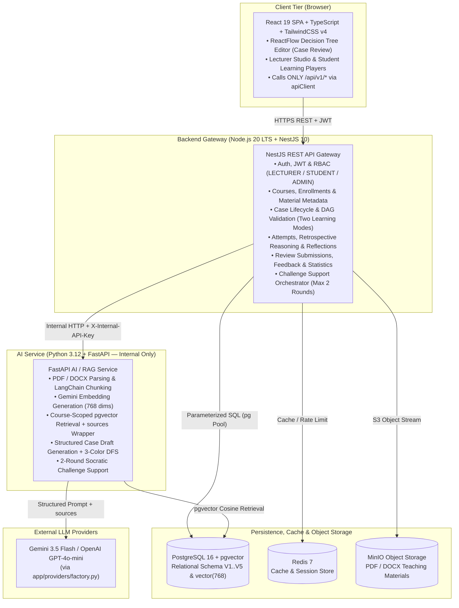

# EduBranch AI — System Architecture

> - **Document Class**: `[LIVING ARCHITECTURE / OPS SPEC]` · **Diagram SSOT**: Canonical 3-Tier Topology Diagram
> - **Implementation Status**: Core 3-Tier Architecture Active on `develop` (see [`docs/PROJECT_OVERVIEW.md`](../PROJECT_OVERVIEW.md) for per-feature status and open items)

---

## High-Level 3-Tier Architecture (Canonical Diagram)

## Architecture Principles

1. **Frontend → Backend only**: React communicates exclusively with the Backend Gateway via REST API; it never calls FastAPI directly.
2. **FastAPI is internal**: Never exposed to the public internet; requires `X-Internal-API-Key` authentication.
3. **Untrusted document content**: Retrieved chunks always wrapped in `<sources>...</sources>` boundary.
4. **Human-in-the-loop**: All AI-generated cases start as `DRAFT`; a lecturer must explicitly approve before publication.
5. **AI does not grade**: Challenge Support generates targeted counter-questions only (no grades, no scores, no pass/fail).

## See Also

- [ADR-001-TECHNOLOGY-STACK.md](ADR-001-TECHNOLOGY-STACK.md)
- [SERVICE-BOUNDARIES.md](SERVICE-BOUNDARIES.md)
- [DATA-FLOW.md](DATA-FLOW.md)
