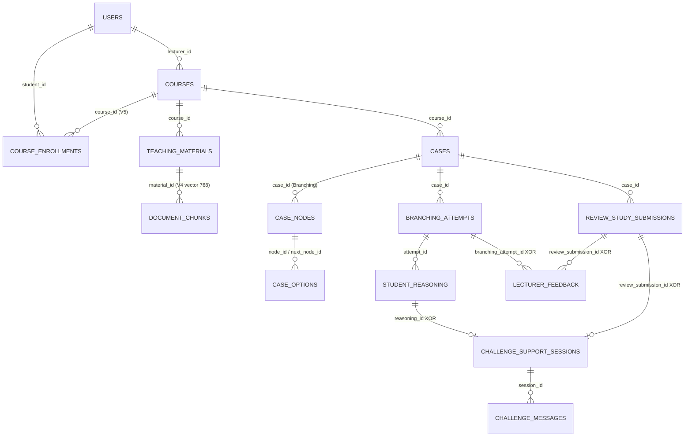

# EduBranch AI — Data Model

> **Document Class**: `[LIVING ARCHITECTURE / OPS SPEC]` — **SSOT for PostgreSQL Schema & Migrations** (`V1`–`V5` executed by Backend Gateway `MigrationRunner`)

---

## 0. Entity Relationship Overview

---

## 1. Core Relational Tables

| Table | Description | Learning Mode |
|---|---|---|
| `users` | All users with role RBAC (`LECTURER`, `STUDENT`, `ADMIN`) and lock state `is_active` | Shared |
| `courses` | Lecturer courses scoped to `lecturer_id`, with `invite_code`, `invite_code_active`, soft-archive `is_active` | Shared |
| `course_enrollments` | Student class enrollments (`course_id`, `student_id`, `UNIQUE(course_id, student_id)`) — V5 | Shared |
| `teaching_materials` | Uploaded PDF/DOCX materials stored in MinIO, metadata in PostgreSQL | Shared |
| `cases` | Case studies supporting both `BRANCHING_STUDY` and `REVIEW_STUDY` | Shared |
| `case_nodes` | Situation nodes in a decision tree | Branching Study |
| `case_options` | Decision options with consequences connecting nodes in a decision tree | Branching Study |
| `branching_attempts` | Student attempts on Branching Study cases, tracking current node, outcome, and reflection | Branching Study |
| `student_reasoning` | Student written justifications submitted at decision points, owned by attempt | Branching Study |
| `review_study_submissions` | Student submissions for Review Study (proposed solution, reasoning, reflection) | Review Study |
| `challenge_support_sessions` | AI Reasoning / Challenge Support sessions (supports both modes, max 2 rounds) | Both |
| `challenge_messages` | Messages within a challenge support session (`CHALLENGE_SUPPORT`, `STUDENT`) | Both |
| `lecturer_feedback` | Qualitative feedback provided by lecturer on attempts or review submissions | Both |

---

## 2. Vector & RAG Tables (FastAPI AI Service)

| Table | Description |
|---|---|
| `document_chunks` | Parsed text chunks with pgvector embeddings (`vector(768)` per V4 `gemini-embedding-001`), linked to `material_id` and `course_id` |

### `teaching_materials.chunk_count` Definition (PO Option 1, 2026-11-28)
- `teaching_materials.chunk_count` stores the **current number of chunk rows existing in `document_chunks`** for that material (not a historical peak).
- Any transition to `FAILED` (both `ai-service` `_mark_failed` and Backend `MaterialService.uploadMaterial` fallback) atomically removes that material's `document_chunks` rows and resets `chunk_count = 0`.

---

## 3. Key Table Details & Constraints

### 3.1 `cases`
- `learning_mode`: VARCHAR(50) NOT NULL CHECK (`learning_mode IN ('BRANCHING_STUDY', 'REVIEW_STUDY')`)
- `status`: VARCHAR(50) NOT NULL CHECK (`status IN ('DRAFT', 'REVIEWED', 'APPROVED', 'PUBLISHED')`)
- `context_text`: TEXT (Review Study background context/data)
- `problem_text`: TEXT (Review Study problem statement/question)
- `root_node_id`: UUID FK → `case_nodes(id)` (Branching Study root pointer)
- `version`: INTEGER NOT NULL DEFAULT 1

### 3.2 `branching_attempts`
- `attempt_number`: INTEGER NOT NULL DEFAULT 1
- `outcome_node_id`: UUID FK → `case_nodes(id)` (recorded when reaching a terminal node)
- `is_completed`: BOOLEAN NOT NULL DEFAULT FALSE
- `reflection_text`: TEXT
- `reflection_status`: VARCHAR(50) NOT NULL CHECK (`reflection_status IN ('NOT_STARTED', 'SUBMITTED')`)
- `reflection_submitted_at`: TIMESTAMPTZ
- **Constraint**: `uq_branching_attempt_number UNIQUE (student_id, case_id, attempt_number)`

### 3.3 `student_reasoning`
- `attempt_id`: UUID NOT NULL FK → `branching_attempts(id)` ON DELETE CASCADE
- `node_id`: UUID NOT NULL FK → `case_nodes(id)`
- `selected_option_id`: UUID NOT NULL FK → `case_options(id)`
- `reasoning_text`: TEXT NULL (populated optionally during the post-journey REVIEW phase)
- **Constraint**: `uq_reasoning_per_node UNIQUE (attempt_id, node_id)` (one reasoning per decision point per attempt)

### 3.4 `review_study_submissions`
- `student_analysis`: TEXT (nullable, R2 Confirmed Option A)
- `proposed_solution`: TEXT NOT NULL
- `reasoning_text`: TEXT NOT NULL
- `submission_status`: VARCHAR(50) NOT NULL CHECK (`submission_status IN ('SUBMITTED', 'REVIEWED', 'REFLECTED')`)
- `reflection_text`: TEXT
- `reflection_status`: VARCHAR(50) NOT NULL CHECK (`reflection_status IN ('NOT_STARTED', 'SUBMITTED')`)
- `reflection_submitted_at`: TIMESTAMPTZ
- **Constraint**: `uq_review_submission_per_student_case UNIQUE (student_id, case_id)`

### 3.5 `challenge_support_sessions`
- `reasoning_id`: UUID UNIQUE FK → `student_reasoning(id)` (nullable)
- `review_submission_id`: UUID UNIQUE FK → `review_study_submissions(id)` (nullable)
- `current_round`: INTEGER NOT NULL DEFAULT 0 CHECK (`current_round >= 0 AND current_round <= 2`)
- `is_completed`: BOOLEAN NOT NULL DEFAULT FALSE
- **Constraint**: `chk_challenge_one_target CHECK ((reasoning_id IS NOT NULL AND review_submission_id IS NULL) OR (reasoning_id IS NULL AND review_submission_id IS NOT NULL))`

### 3.6 `challenge_messages`
- `session_id`: UUID NOT NULL FK → `challenge_support_sessions(id)` ON DELETE CASCADE
- `round_number`: INTEGER NOT NULL CHECK (`round_number >= 1 AND round_number <= 2`)
- `role`: VARCHAR(50) NOT NULL CHECK (`role IN ('CHALLENGE_SUPPORT', 'STUDENT')`)
- `content`: TEXT NOT NULL

### 3.7 `lecturer_feedback`
- `lecturer_id`: UUID NOT NULL FK → `users(id)`
- `branching_attempt_id`: UUID FK → `branching_attempts(id)` (nullable)
- `review_submission_id`: UUID FK → `review_study_submissions(id)` (nullable)
- `feedback_text`: TEXT NOT NULL
- **Constraint**: `chk_feedback_one_target CHECK ((branching_attempt_id IS NOT NULL AND review_submission_id IS NULL) OR (branching_attempt_id IS NULL AND review_submission_id IS NOT NULL))`

---

## 4. Migrations

Migrations are maintained in SQL files executed against PostgreSQL:
- Backend migrations directory: `backend/migrations/` — the only directory the migration runner reads (`backend/src/common/database/migration-runner.ts`, advisory lock, on backend start when `AUTO_MIGRATE` is not false).
- `infrastructure/postgres/migrations/` is a stale copy (V1–V4, no V5) that nothing executes; do not edit it as a source. Compose mounts only `infrastructure/postgres/init/` (extensions).
- **V1__init_schema.sql**: Initial baseline schema
- **V2__new_flow_schema.sql**: Proposal V1.2 flow schema (cases extensions, branching_attempts, student_reasoning, review_study_submissions, challenge_support_sessions, challenge_messages, lecturer_feedback)
- **V3__add_admin_role.sql**: Updates `users.role` check constraint to support `ADMIN` (matches Proposal V1.2 System Context Diagram)
- **V4__document_chunks.sql**: `document_chunks` with `vector(768)` embeddings for RAG (Gemini `gemini-embedding-001`, 768 dims; the file header still names the retired `text-embedding-004`)
- **V5__course_enrollments.sql**: `courses.invite_code` (unique) and `invite_code_active`; `course_enrollments(course_id, student_id)` with `UNIQUE(course_id, student_id)` (BE-029, OPD-001 → A)
- V1 still creates the retired tables `simulation_sessions`, `student_arguments`, `debate_sessions`, `debate_messages`; no code uses them.

---

## 5. Naming Convention

- Table names: `snake_case`, plural (e.g., `branching_attempts`, `student_reasoning`)
- Column names: `snake_case` (e.g., `attempt_number`, `current_round`)
- Primary keys: `id UUID DEFAULT uuid_generate_v4()`
- Foreign keys: `<referenced_entity>_id UUID`
- Timestamps: `created_at TIMESTAMPTZ`, `updated_at TIMESTAMPTZ`

---

## 6. Additions from spec 007 (migrations V6–V8)

Source: `specs/007-mvp-completion-backend/data-model.md`. All additive; no existing column or constraint changes.

| Migration | Table / column | Purpose |
|---|---|---|
| **V6__user_preferred_language.sql** | `users.preferred_language` `VARCHAR(5) NOT NULL DEFAULT 'vi'`, `CHECK IN ('vi','en')` | Interface language of the profile (BE-031) |
| **V7__audit_events_and_settings.sql** | `audit_events(id, event_type, outcome, actor_id → users ON DELETE SET NULL, target_id, meta JSONB, created_at)` with a `CHECK` on the 10 event types | System activity log for Admin 10.2 / 10.7 / 10.9 (BE-032). `meta` holds non-sensitive context only: no passwords, tokens, typed e-mails of failed logins or student text |
| | `system_settings(key PK CHECK IN 5 keys, value, updated_by, updated_at)` | Editable platform information for Admin 10.10 (BE-032) |
| **V8__case_rubric_evaluations.sql** | `case_rubric_evaluations(case_id → cases ON DELETE CASCADE, evaluator_id → users, realism/difficulty/alignment_score SMALLINT 1–5, notes ≤ 2000, UNIQUE(case_id, evaluator_id))` | Case quality rubric (BE-033, FR-EVAL-01, OPD-011 → A). Rates the case, never a student |

`users.is_active` (V1) is now enforced: a locked account cannot log in and its issued tokens are refused (spec 007 AC-A5).
