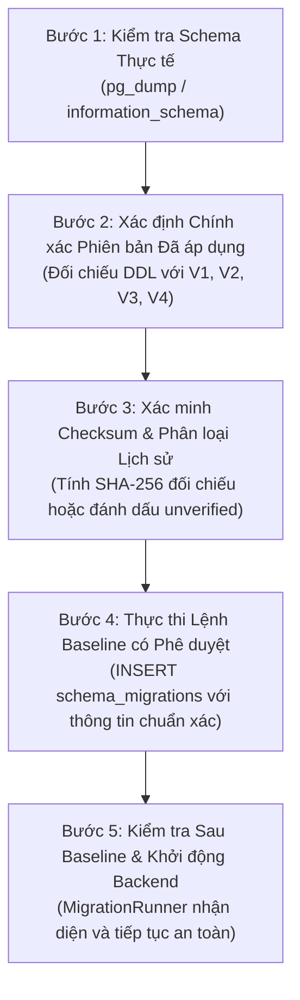

# Hướng dẫn Vận hành: Quy trình Baseline Cơ sở Dữ liệu Cũ (Operational Baseline Guide)

## 1. Mục đích & Nguyên tắc Bắt buộc
Tài liệu này quy định quy trình chuẩn hóa cho Quản trị viên Hệ thống (DevOps / Database Administrator) khi kết nối EduBranch-AI Backend Gateway vào một cơ sở dữ liệu PostgreSQL đã tồn tại bảng từ các phiên bản triển khai trước đó hoặc tạo thủ công.

### NGUYÊN TẮC CỐT LÕI (IMMUTABLE RULES)
1. **Tuyệt đối không suy đoán**: Việc bảng `users` hoặc bất kỳ bảng nào khác tồn tại **KHÔNG PHẢI** là bằng chứng chứng minh database đã áp dụng đầy đủ các migration `V1 → V4`.
2. **Không tự động dán nhãn (No Auto-Stamping)**: `MigrationRunner` được thiết kế để `SAFE-FAIL` (dừng ngay lập tức và ROLLBACK) nếu phát hiện xung đột bảng mà không tự động chèn bản ghi giả mạo vào `schema_migrations`.
3. **Phê duyệt có kiểm soát**: Mọi thao tác baseline dữ liệu lịch sử phải được thực hiện thủ công bởi người vận hành sau khi đối soát đầy đủ 5 bước dưới đây.

---

## 2. Quy trình 5 bước Baseline Database có kiểm soát



### Bước 1: Kiểm tra Schema Thực tế (Schema Inspection)
Trước khi khởi động backend, trích xuất cấu trúc hiện tại của database để kiểm tra:

```bash
# 1. Trích xuất danh sách bảng và cột
psql -U <db_user> -d <db_name> -c "\dt public.*"

# 2. Kiểm tra các extension đã cài đặt
psql -U <db_user> -d <db_name> -c "SELECT extname, extversion FROM pg_extension;"
```

### Bước 2: Xác định Chính xác Phiên bản Migration đã Áp dụng
Đối chiếu danh sách bảng và cột thực tế với các file migration trong `backend/migrations/`:

| Phiên bản File SQL | Bảng & Cột Nhận diện Đặc trưng | Kiểm tra Tương ứng |
|---|---|---|
| `V1__init_schema.sql` | `users`, `courses`, `teaching_materials`, `cases`, `case_nodes`, `case_options` | `SELECT column_name FROM information_schema.columns WHERE table_name = 'cases' AND column_name = 'root_node_id';` |
| `V2__new_flow_schema.sql` | `branching_attempts`, `student_reasoning`, `review_study_submissions`, `challenge_support_sessions`, `lecturer_feedback` | `SELECT table_name FROM information_schema.tables WHERE table_name = 'branching_attempts';` |
| `V3__add_admin_role.sql` | Enum `user_role` có giá trị `'ADMIN'` | `SELECT enumlabel FROM pg_enum WHERE enumtypid = 'user_role'::regtype;` |
| `V4__document_chunks.sql` | `document_chunks` với vector embedding | `SELECT table_name FROM information_schema.tables WHERE table_name = 'document_chunks';` |

> **Cảnh báo**: Nếu database mới chỉ có bảng của `V1` mà chưa có bảng của `V2`, **tuyệt đối không** đánh dấu `V2` đã hoàn thành!

### Bước 3: Xác minh Checksum hoặc Ghi nhận Lịch sử Chưa thể Xác minh
Tính toán SHA-256 checksum của file SQL trên đĩa:

```powershell
# Trên Windows PowerShell:
Get-FileHash backend/migrations/V1__init_schema.sql -Algorithm SHA256
Get-FileHash backend/migrations/V2__new_flow_schema.sql -Algorithm SHA256
Get-FileHash backend/migrations/V3__add_admin_role.sql -Algorithm SHA256
Get-FileHash backend/migrations/V4__document_chunks.sql -Algorithm SHA256
```

- **Trường hợp A (Xác nhận khớp 100%)**: Nếu người vận hành có log triển khai trước đây chứng minh các file SQL trên được chạy nguyên vẹn, sử dụng giá trị SHA-256 tương ứng để lưu vào cột `checksum`.
- **Trường hợp B (Lịch sử không thể xác minh - Unverified Legacy)**: Nếu cấu trúc DB được tạo từ script cũ không rõ nguồn gốc hoặc đã bị chỉnh sửa bằng tay, đặt `checksum = NULL`. `MigrationRunner` của EduBranch-AI sẽ ghi nhận cảnh báo `(legacy unverified)` và bỏ qua file mà không gây lỗi dừng hệ thống.

### Bước 4: Thực thi Lệnh Baseline được Phê duyệt (Approval Execution)
Khởi tạo bảng theo dõi và nạp bản ghi baseline tương ứng với các phiên bản **đã được chứng minh tồn tại thực tế**:

```sql
-- 1. Khởi tạo bảng tracking nếu chưa có
CREATE TABLE IF NOT EXISTS schema_migrations (
    version VARCHAR(255) PRIMARY KEY,
    name VARCHAR(255) NOT NULL,
    checksum VARCHAR(64),
    applied_at TIMESTAMPTZ NOT NULL DEFAULT NOW()
);

-- 2. Đảm bảo có cột checksum
ALTER TABLE schema_migrations ADD COLUMN IF NOT EXISTS checksum VARCHAR(64);

-- 3. Nạp bản ghi baseline (Ví dụ đã xác minh có đầy đủ V1 đến V4 khớp file gốc)
INSERT INTO schema_migrations (version, name, checksum, applied_at)
VALUES 
    ('V1', 'init_schema', 'cf42c99b6cefdf3b2c6d0900ae73b1122164835192ddca5bf8ca314544c5cb30', NOW()),
    ('V2', 'new_flow_schema', 'ae92835c4cd5e52da3f94a1120f269a6fc460f994e4c29bc962f905fbcf9698c', NOW()),
    ('V3', 'add_admin_role', '1f0fd89c3168b5a03e680aee80c2f7b11d871d34c679093b16327b8782a9a4b1', NOW()),
    ('V4', 'document_chunks', '61acb30e2b13dbb3e51352a9f44efd7e68cfb99db1be4b18eb3ef061cb9bb759', NOW())
ON CONFLICT (version) DO NOTHING;
```

### Bước 5: Kiểm tra Sau Baseline & Khởi động Backend
1. Chạy câu lệnh kiểm tra:
   ```sql
   SELECT * FROM schema_migrations ORDER BY version;
   ```
2. Khởi động Backend Gateway với biến môi trường `AUTO_MIGRATE=true`.
3. Quan sát log khởi động:
   ```text
   [MigrationRunner] Acquiring PostgreSQL advisory lock (1162106178, 1380011587)...
   [MigrationRunner] PostgreSQL advisory lock acquired successfully.
   [MigrationRunner] Migration run complete: 0 applied, 4 skipped.
   [MigrationRunner] Releasing PostgreSQL advisory lock (1162106178, 1380011587)...
   [MigrationRunner] PostgreSQL advisory lock released successfully.
   ```
4. Hệ thống chuyển sang trạng thái sẵn sàng phục vụ mà không phát sinh xung đột DDL.

---

## 3. Quy chuẩn Soạn thảo Migration SQL & Giới hạn Transactional DDL

### 3.1. Cơ chế Transactional DDL của MigrationRunner
- `MigrationRunner` thực thi nội dung của từng file migration bên trong một khối transaction cô lập (`BEGIN ... COMMIT`).
- Nếu bất kỳ câu lệnh SQL nào trong file thất bại, toàn bộ file sẽ được `ROLLBACK` và không được ghi nhận vào `schema_migrations`.
- PostgreSQL hỗ trợ transactional DDL cho hầu hết các câu lệnh thông thường (`CREATE TABLE`, `ALTER TABLE`, `CREATE INDEX`, `DROP TABLE`, `DROP CONSTRAINT`).

### 3.2. Giới hạn Bắt buộc (Non-Transactional DDL Limitation)
- **Tuyệt đối không sử dụng các câu lệnh yêu cầu chạy ngoài transaction block** bên trong các file migration `V*.sql`, bao gồm:
  - ❌ `CREATE INDEX CONCURRENTLY`
  - ❌ `DROP INDEX CONCURRENTLY`
  - ❌ `VACUUM`
  - ❌ `REINDEX CONCURRENTLY`
- **Hệ quả**: Nếu một file migration chứa các câu lệnh trên, PostgreSQL sẽ báo lỗi `ERROR: CREATE INDEX CONCURRENTLY cannot run inside a transaction block`. Quá trình migration sẽ rollback, ném exception và dừng toàn bộ tiến trình khởi động của Backend Gateway.
- **Quy chuẩn**: Toàn bộ index trong hệ thống (bao gồm B-Tree và HNSW index cho `pgvector`) phải được tạo dưới dạng index thông thường (`CREATE INDEX idx_name ON table_name USING ...`). Toàn bộ migration hiện tại (`V1 → V4`) đã tuân thủ nghiêm ngặt quy chuẩn này.

