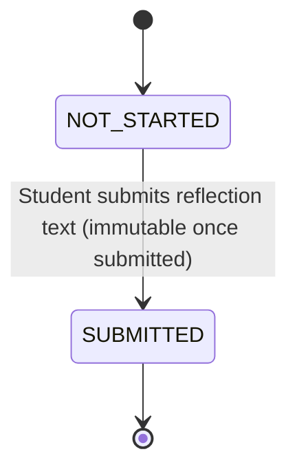

# Feature: Student Reflection

> - **Document Class**: `[LIVING FEATURE SPEC]` · **Authoritative Traceability**: Proposal V1.2 (lines 35, 37, 60–61, 76–77)
> - **Target Package / Module**: Backend `branching-attempt/`, `review-study/` · Frontend `pages/branching/ReflectionPage.tsx`, `pages/feedback/ReviewFeedbackPage.tsx`

## 1. Overview & Source of Truth

- **Source of Truth**: Proposal V1.2 (`docs/C1SE_65-EduBranch-AI-Proposal_V1.2.docx`).
- **Core Purpose**: Reflection is a core pedagogical artifact in EduBranch AI. It encourages meta-cognitive learning, allowing students to evaluate their decision path or solution justification in hindsight.
- **Support Across Both Modes**:
  1. **Branching Study**: Triggered after reaching a terminal outcome node (`outcome_node_id`). Students reflect on the chain of decisions, trade-offs, and resulting outcome before deciding whether to attempt the case again.
  2. **Review Study**: Triggered after the lecturer reviews the submission and provides feedback (`lecturer_feedback`). Students reflect on the feedback, critique their proposed solution, and note areas of improvement.

---

## 2. Lifecycle & State Machine

- In Branching Study, `reflection_status` is tracked on `branching_attempts`.
- In Review Study, `reflection_status` is tracked on `review_study_submissions`. When reflection is submitted, `submission_status` transitions from `REVIEWED` to `REFLECTED`.

---

## 3. Storage Model

### In Branching Study (`branching_attempts` table)
- `reflection_text`: TEXT (nullable until submitted)
- `reflection_status`: VARCHAR(50) NOT NULL DEFAULT 'NOT_STARTED' CHECK (reflection_status IN ('NOT_STARTED', 'SUBMITTED'))
- `reflection_submitted_at`: TIMESTAMPTZ (set upon submission)

### In Review Study (`review_study_submissions` table)
- `reflection_text`: TEXT (nullable until submitted)
- `reflection_status`: VARCHAR(50) NOT NULL DEFAULT 'NOT_STARTED' CHECK (reflection_status IN ('NOT_STARTED', 'SUBMITTED'))
- `reflection_submitted_at`: TIMESTAMPTZ (set upon submission)

---

## 4. Governance & AI Isolation

1. **No AI Grading of Reflection**: AI models are NEVER used to score, judge, or grade student reflections.
2. **Pedagogical Ownership**: Reflections are accessible to the lecturer for qualitative review and to the student for self-assessment across attempts.

---

## 5. Implementation Status
**Implemented**
*(Reflection submission endpoints and read-only post-submission screens `ReflectionPage.tsx` and `ReviewFeedbackPage.tsx` are implemented on `develop`.)*
