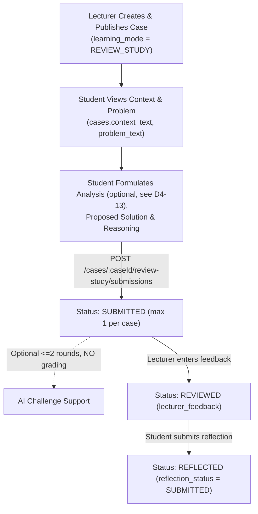

# Feature: Review Study (Simple MVP)

> - **Document Class**: `[LIVING FEATURE SPEC]` · **Authoritative Traceability**: Proposal V1.2 (lines 37, 61, 77)
> - **Target Package / Module**: Backend `review-study/` · Frontend `pages/review-study/ReviewStudyPage.tsx`, `pages/feedback/ReviewFeedbackPage.tsx`
> - **MVP Scope Status**: **MVP Scope** (`(LATER)` label removed per PO `2026-11-25`, Figma `06.1`–`06.3` synchronized in [`P4-REVIEW-STUDY.md`](../design/screens/P4-REVIEW-STUDY.md)). *(MVP scope is distinct from full implementation/verification: open UI check **`D4-13`** remains **`OPEN PO DECISION / UNRESOLVED`**, and draft/badge/Visual E2E checks remain open even though core `BE-025` / `ReviewStudyPage.tsx` merged on `develop`).*

## 1. Overview & Source of Truth

- **Source of Truth**: Proposal V1.2 (`docs/C1SE_65-EduBranch-AI-Proposal_V1.2.docx`).
- **Core Purpose**: Review Study is one of EduBranch AI's two distinct learning modes. In the MVP, it provides a simple, structured case analysis workflow where students receive case context, relevant data, and an open problem, analyze it, propose their own solution, justify it with reasoning, receive lecturer feedback, and engage in reflection.
- **Fundamental Principle**: Case study education recognizes multiple valid perspectives. The system **does not determine a single correct answer or reasoning**, nor does AI assign grades.

---

## 2. Learning Flow

---

## 3. Data Model & Invariants

- **Table**: `review_study_submissions`
  - `id`: UUID primary key
  - `student_id`: UUID REFERENCES `users(id)`
  - `case_id`: UUID REFERENCES `cases(id)`
  - `student_analysis`: TEXT (nullable, R2 = CONFIRMED OPTION A)
  - `proposed_solution`: TEXT NOT NULL
  - `reasoning_text`: TEXT NOT NULL
  - `submission_status`: VARCHAR(50) — `SUBMITTED` → `REVIEWED` → `REFLECTED`
  - `reflection_text`: TEXT
  - `reflection_status`: VARCHAR(50) — `NOT_STARTED` → `SUBMITTED`
  - `reflection_submitted_at`: TIMESTAMPTZ
  - `submitted_at`: TIMESTAMPTZ NOT NULL DEFAULT NOW()
  - `updated_at`: TIMESTAMPTZ NOT NULL DEFAULT NOW()
- **Cardinality Constraint**: `CONSTRAINT uq_review_submission_per_student_case UNIQUE (student_id, case_id)`.
  - Exactly **one submission** per student per Review Study case in MVP.
  - There is **no retry / re-submission** in Review Study (unlike Branching Study).

---

## 4. Architectural Boundaries & Guardrails

1. **No Decision Tree**: Review Study cases do NOT use `case_nodes` or `case_options`. `root_node_id` on `cases` is NULL.
2. **No Automated Grading**: AI does NOT evaluate pass/fail or assign numerical scores to student solutions or reasoning.
3. **Lecturer Authority**: Academic review and feedback belong entirely to the course lecturer.
4. **Publication Guard**: Students cannot access Review Study cases that are not in `PUBLISHED` status.

> **Open PO Item (`D4-13`)**: Database schema (`V2__new_flow_schema.sql`) keeps `student_analysis` nullable; final UI enforcement (`required` vs optional in Figma `06.1`) remains tracked in [`PRODUCT_OWNER_SCOPE_DECISIONS.md`](../mvp-scope/PRODUCT_OWNER_SCOPE_DECISIONS.md).

---

## 5. Implementation Status
**Implemented**
*(Backend `review-study/` `BE-025` merged in PR #76 and frontend `ReviewStudyPage.tsx` / `ReviewFeedbackPage.tsx` merged in PR #63 / #69 on `develop`; Visual QA & live E2E suites tracked in Jira.)*
